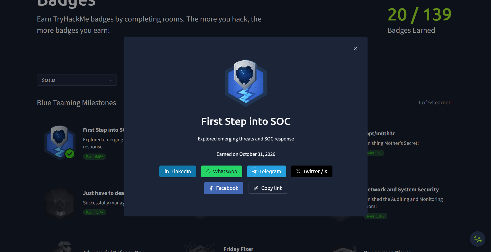

# Blue Team Introduction

## Overview

This section documents my foundational learning in Blue Team operations and Security Operations Center (SOC) environments through the TryHackMe SOC Level 1 learning path.

The focus is on understanding defensive security operations, SOC responsibilities, security analyst roles, and common attack vectors targeting people and systems.

## Learning Objectives

- Understand the fundamentals of Blue Team operations.
- Explore the structure and responsibilities of a Security Operations Center (SOC).
- Understand the responsibilities of a Junior Security Analyst.
- Identify how humans can be targeted in cyber attacks.
- Understand common system-based attack vectors.
- Recognize the role of defensive security teams in detecting and responding to threats.

## Completed Practical Training

| Room | Main Focus | Status |
|---|---|---|
| Junior Security Analyst Intro | Security analyst responsibilities and daily activities | Completed |
| SOC Role in Blue Team | SOC structure and defensive security roles | Completed |
| Humans as Attack Vectors | Human-targeted attacks and social engineering | Completed |
| Systems as Attack Vectors | System vulnerabilities and attack vectors | Completed |

## Key Knowledge Areas

- Blue Team Fundamentals
- Security Operations Center (SOC)
- SOC Analyst Roles and Responsibilities
- Human-Based Attack Vectors
- System-Based Attack Vectors
- Defensive Security Fundamentals

## Key Takeaways

This learning section established my foundational understanding of defensive security operations and the role of SOC analysts in identifying, monitoring, and responding to security threats.

It also highlighted the importance of understanding both human and technical attack surfaces when assessing organizational security.

## Next Learning Step

Continue with SOC Team Internals and develop a deeper understanding of SOC workflows, alert handling, and security monitoring.

## Learning Source

---

## TryHackMe Achievements

### First Step into SOC

**Achievement:** First Step into SOC

**Platform:** TryHackMe

**Earned:** October 31, 2026

[View Official Badge](https://tryhackme.com/Rahafalsulami/badges/first-step-into-soc)
- [TryHackMe – SOC Level 1](https://tryhackme.com/path/outline/soclevel1)

---

*This repository documents my hands-on cybersecurity learning journey. All practical activities are performed in authorized training environments.*
